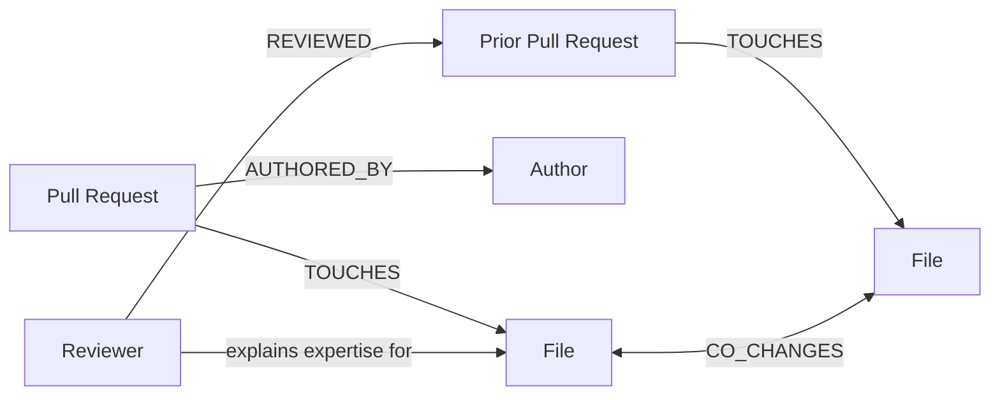

# Keystone — A Graph Helper That Picks PR Reviewers

Keystone helps choose the best person to review a pull request (PR). A PR is a request to add code to a project. A reviewer is a person who checks that code. Keystone uses a live map called a graph in FalkorDB. The map connects PRs, files, authors, reviews, and files that often change together. Every suggestion comes with real reasons from the map. It does not use a fixed list or a fake demo answer.


## Why we built this

Picking a reviewer matters. A good reviewer catches problems early. A bad choice can slow things down and keep knowledge stuck with one person. Normal CODEOWNERS files say who “owns” a file. But they do not know who reviewed recently, which files change together, or who connects important parts of the code. Keystone uses that connected history to give a clear suggestion that a developer can check and trust.

## What makes Keystone special

- **It uses the graph first:** It ranks reviewers by looking at FalkorDB links like `TOUCHES`, `REVIEWED`, and `CO_CHANGES`. These mean “worked on”, “reviewed”, and “changed together”.
- **It shows why:** Each person gets a score with shared files, recent reviews, how closely connected they are, and a graph path you can inspect.
- **One brain, two doors:** The web app and FastMCP tools use the same graph-based ranking and explanation.
- **It is safe to automate:** Cypher (the graph question language) is read-only and limited. It rejects changes, restricted procedures, deep searches, and huge results. Actions support `DRY_RUN` (pretend), `SHADOW` (watch), and `LIVE` (really do it) only after clear confirmation and only for repos on an allow-list.

## How it works

Keystone turns the history around a PR into a connected graph. Then it scores each reviewer using shared-file knowledge, recent reviews, how recent the work is, and how often files change together.



## Main things it can do

| Capability | What it gives you |
| --- | --- |
| Reviewer routing | Ranks reviewers using graph reasons, not a fixed rule. |
| Explanation paths | Shows the shortest path linking a PR, its files, and a reviewer. |
| Knowledge-risk signals | Shows which files are very important and where knowledge may be stuck with one person. |
| Repository ingestion | Loads PR and review history into FalkorDB. |
| MCP tools | Lets other compatible tools ask for reviewer rankings and graph explanations. |
| Safe Cypher queries | Lets people explore the graph read-only and with limits. It rejects changes, restricted procedures, deep searches, and too-large results. |
| Controlled actions | Auditable `DRY_RUN`, `SHADOW`, and allow-listed `LIVE` actions. |

## Product walkthrough

### 1. Send a PR to a reviewer and show why

Keystone shows the chosen PR, what it covers, the top reviewer, and the reasons behind the pick in one place.


### 2. Look through the saved PR history

The PR explorer shows what is included and excluded. Teams can search, filter, and focus on risky or under-reviewed changes.


### 3. Control data loading and graph freshness

The repository health page shows what will be loaded, progress, review count, and whether centrality was calculated before routing uses the data.


### 4. Look inside the FalkorDB graph

The graph has PRs, files, people, reviews, and files that change together. These are the facts behind each suggestion.


## Project layout

```text
backend/             FastAPI service, FalkorDB queries, scoring, and MCP tools
frontend/            Web UI and graph visualisation
assets/              Judge-facing diagrams and screenshots
tests/               API, ingestion, scoring, and safety tests
.github/workflows/   Continuous-integration workflow
```

## Safety notes

Keystone is made so you can inspect its suggestions before it does anything. Start with `DRY_RUN` or `SHADOW`, check the action ledger, and only turn on `LIVE` actions for repositories you put in `KEYSTONE_WRITE_REPOS`.
