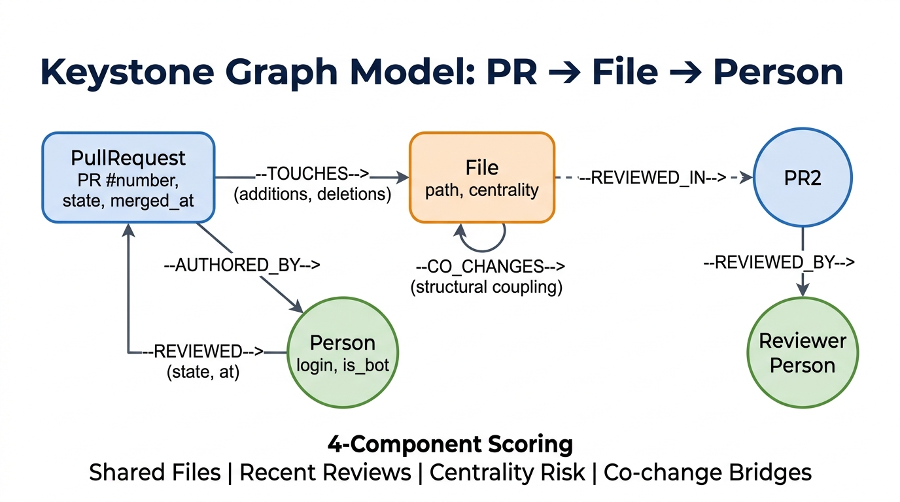
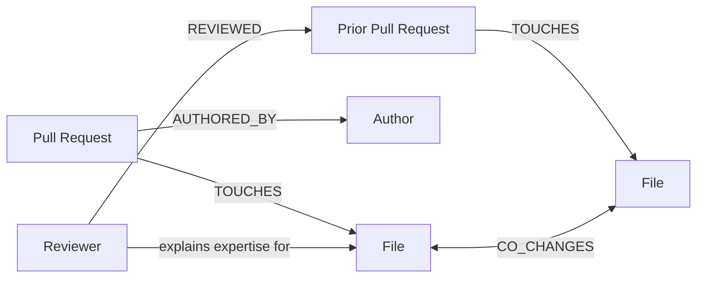

# Keystone — Graph-Powered PR Reviewer Routing

Keystone recommends the best reviewers for a pull request by traversing a live
FalkorDB knowledge graph of pull requests, files, authors, reviews, and
co-change history. Every recommendation is backed by concrete graph evidence,
not a static ownership file or a hard-coded demo result.



## Why we chose this project

Review assignment is deceptively high impact: the right reviewer catches risk
early, while the wrong one creates bottlenecks and leaves knowledge siloed.
Conventional CODEOWNERS rules describe nominal ownership, but they do not adapt
to recent review activity, files that change together, or the people who bridge
critical parts of a codebase. Keystone turns that connected history into a
transparent recommendation that a developer can inspect and trust.

## What makes Keystone different

- **Graph-first reasoning:** reviewer ranking is derived from FalkorDB
  relationships such as `TOUCHES`, `REVIEWED`, and `CO_CHANGES`.
- **Explainable results:** each candidate includes file overlap, recent-review
  signals, structural affinity, and an inspectable graph path.
- **One engine, multiple interfaces:** the web app and FastMCP tools use the
  same graph-backed ranking and explanation logic.
- **Safe automation:** Cypher exploration is read-only and bounded; execution
  supports `DRY_RUN`, `SHADOW`, and explicitly confirmed `LIVE` modes with a
  repository allow-list.

## How it works

Keystone models the engineering history around a pull request as a connected
graph, then scores each reviewer using shared-file expertise, recent reviews,
recency, and structural co-change affinity.



## Core capabilities

| Capability | What it provides |
| --- | --- |
| Reviewer routing | Ranked reviewers based on graph evidence rather than a fixed rule. |
| Explanation paths | Shortest-path evidence that connects a PR, its files, and a reviewer. |
| Knowledge-risk signals | Centrality and co-change signals for critical files and potential silos. |
| Repository ingestion | Pull-request and review history loaded into FalkorDB for analysis. |
| MCP tools | Programmatic reviewer ranking and graph explanations for compatible clients. |
| Safe Cypher queries | Read-only, bounded graph exploration; mutations, restricted procedures, deep traversals, and oversized results are rejected. |
| Controlled actions | Auditable `DRY_RUN`, `SHADOW`, and allow-listed `LIVE` execution. |

## Product walkthrough

### 1. Route a pull request to an explainable reviewer

Keystone presents the selected PR, its coverage context, the ranked reviewer,
and the evidence behind the recommendation in one reviewable workflow.


### 2. Explore the ingested pull-request history

The PR explorer makes scope and exclusions visible while allowing teams to
search, filter, and prioritise high-risk or under-reviewed changes.


### 3. Control ingestion and graph freshness

Repository health exposes the ingestion scope, progress, review count, and
centrality-materialisation choice before data is used for routing.


### 4. Inspect the underlying FalkorDB graph

The populated graph contains pull requests, files, people, and their review and
co-change relationships—the evidence base that powers each recommendation.


## Project layout

```text
backend/             FastAPI service, FalkorDB queries, scoring, and MCP tools
frontend/            Web UI and graph visualisation
assets/              Judge-facing diagrams and screenshots
tests/               API, ingestion, scoring, and safety tests
.github/workflows/   Continuous-integration workflow
```

## Safety notes

Keystone is designed to make its recommendations inspectable before it takes an
action. Start in `DRY_RUN` or `SHADOW` mode, review the action ledger, and only
enable `LIVE` actions for repositories you explicitly place in
`KEYSTONE_WRITE_REPOS`.
